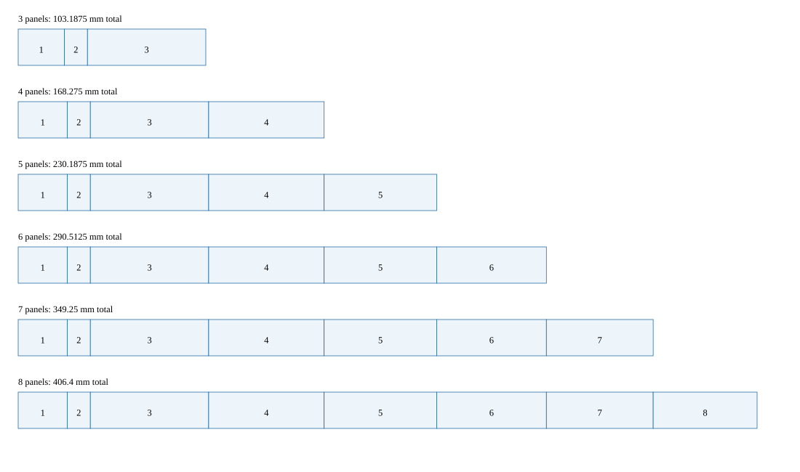

# Generate Standard Cassette J-card formats

The supported profiles use the independently checked Standard Cassette templates.
Use the physical panel count in the profile ID; `faces` separately selects front,
back or both. The existing default remains `nac-jcard-8-panel-v1`.

All formats use the same workflow. Keep certificate verification enabled when
retrieving source references. The checked PDFs and hashes are listed in the
[dimension source record](../reference/jcard-profile-sources.md).



The diagram uses one horizontal scale; panel heights are compressed for reading.
It is diagnostic, not a plot template. Back views reverse these physical IDs.

## Complete recipes

Save these two files beside any standalone configuration below. Paths are relative
to the configuration file. Repository configs already have these sibling recipes.

Save as `front-recipe.json` (continuous front curves):

```json
{
  "domains": [],
  "passes": [
    {
      "algorithm": "truchet",
      "id": "tiles",
      "logical_layers": [
        {
          "id": "curve"
        },
        {
          "id": "fill"
        }
      ],
      "parameters": {
        "curve_layer_ids": [
          "curve"
        ],
        "region_fills": {},
        "tile_size": 48.0
      },
      "target_domain_ids": []
    }
  ],
  "schema_version": 1,
  "seed": 31
}
```

Save as `back-recipe.json` (independent back with hatching):

```json
{
  "domains": [],
  "passes": [
    {
      "algorithm": "truchet",
      "id": "tiles",
      "logical_layers": [
        {
          "id": "curve"
        },
        {
          "id": "fill"
        }
      ],
      "parameters": {
        "curve_layer_ids": [
          "curve"
        ],
        "region_fills": {
          "painted": {
            "effect": "parallel-hatch",
            "layer_id": "fill",
            "parameters": {
              "spacing": 12.0
            }
          }
        },
        "tile_size": 64.0
      },
      "target_domain_ids": []
    }
  ],
  "schema_version": 1,
  "seed": 67
}
```

## Complete format configurations

Each example enables cut, fold and registration ink. The title/spine front artwork
is deliberately blank. Remove `front-panel-2` from `blank_panels` to draw there.
Set guide flags to false for production artwork without construction marks.
The back view reverses physical panel order; strokes are never mirrored.

### 3 panels

Save as `standard-3.json`:

```json
{
  "back_artwork": {
    "blank_panels": [],
    "mode": "independent",
    "template": "back-recipe.json"
  },
  "faces": "both",
  "flip": "left-right",
  "front_artwork": {
    "blank_panels": [
      "front-panel-2"
    ],
    "mode": "continuous",
    "template": "front-recipe.json"
  },
  "guides": {
    "cut": true,
    "fold": true,
    "registration": true
  },
  "margin_mm": 3,
  "profile": "standard-jcard-3-panel-v1",
  "safe_inset_mm": 1.5875,
  "schema_version": 1,
  "sheet": "letter"
}
```

### 4 panels

Save as `standard-4.json`:

```json
{
  "back_artwork": {
    "blank_panels": [],
    "mode": "independent",
    "template": "back-recipe.json"
  },
  "faces": "both",
  "flip": "left-right",
  "front_artwork": {
    "blank_panels": [
      "front-panel-2"
    ],
    "mode": "continuous",
    "template": "front-recipe.json"
  },
  "guides": {
    "cut": true,
    "fold": true,
    "registration": true
  },
  "margin_mm": 3,
  "profile": "standard-jcard-4-panel-v1",
  "safe_inset_mm": 1.5875,
  "schema_version": 1,
  "sheet": "a4"
}
```

### 5 panels

Save as `standard-5.json`:

```json
{
  "back_artwork": {
    "blank_panels": [],
    "mode": "independent",
    "template": "back-recipe.json"
  },
  "faces": "both",
  "flip": "left-right",
  "front_artwork": {
    "blank_panels": [
      "front-panel-2"
    ],
    "mode": "continuous",
    "template": "front-recipe.json"
  },
  "guides": {
    "cut": true,
    "fold": true,
    "registration": true
  },
  "margin_mm": 3,
  "profile": "standard-jcard-5-panel-v1",
  "safe_inset_mm": 1.5875,
  "schema_version": 1,
  "sheet": "letter"
}
```

### 6 panels

Save as `standard-6.json`:

```json
{
  "back_artwork": {
    "blank_panels": [],
    "mode": "independent",
    "template": "back-recipe.json"
  },
  "faces": "both",
  "flip": "left-right",
  "front_artwork": {
    "blank_panels": [
      "front-panel-2"
    ],
    "mode": "continuous",
    "template": "front-recipe.json"
  },
  "guides": {
    "cut": true,
    "fold": true,
    "registration": true
  },
  "margin_mm": 3,
  "profile": "standard-jcard-6-panel-v1",
  "safe_inset_mm": 1.5875,
  "schema_version": 1,
  "sheet": "a3"
}
```

### 7 panels

Save as `standard-7.json`:

```json
{
  "back_artwork": {
    "blank_panels": [],
    "mode": "independent",
    "template": "back-recipe.json"
  },
  "faces": "both",
  "flip": "left-right",
  "front_artwork": {
    "blank_panels": [
      "front-panel-2"
    ],
    "mode": "continuous",
    "template": "front-recipe.json"
  },
  "guides": {
    "cut": true,
    "fold": true,
    "registration": true
  },
  "margin_mm": 3,
  "profile": "standard-jcard-7-panel-v1",
  "safe_inset_mm": 1.5875,
  "schema_version": 1,
  "sheet": "tabloid"
}
```

### 8 panels

Save as `standard-8.json`:

```json
{
  "back_artwork": {
    "blank_panels": [],
    "mode": "independent",
    "template": "back-recipe.json"
  },
  "faces": "both",
  "flip": "left-right",
  "front_artwork": {
    "blank_panels": [
      "front-panel-2"
    ],
    "mode": "continuous",
    "template": "front-recipe.json"
  },
  "guides": {
    "cut": true,
    "fold": true,
    "registration": true
  },
  "margin_mm": 3,
  "profile": "standard-jcard-8-panel-v1",
  "safe_inset_mm": 1.5875,
  "schema_version": 1,
  "sheet": "a3"
}
```

## Generate, restore and impose a sample

The commands below use the three-panel example. Replace `standard-3.json` and the
output directory name to run another complete config above. Run plotter commands
with the plotter-workflow Python environment and generator commands with the
viz_virtualserver Python environment. `C:/art/jcard3` is an example output location.

From plotter-workflow:

```powershell
python scripts/export_jcard_layout.py --config examples/jcard/standard-3.json --output-dir C:/art/jcard3/export
```

Inspect both `layout-preview.svg` (native panel layout) and `sheet-preview.svg`
(physical placement, safe inset and enabled guide geometry) under each face.
These previews contain diagnostic text and must not be sent as plotting inputs.

From viz_virtualserver:

```powershell
python -m viz_virtualserver.cli.domain_bundle C:/art/jcard3/export/front/artwork-job.json --output-dir C:/art/jcard3/front-producer
python -m viz_virtualserver.cli.domain_bundle C:/art/jcard3/export/back/artwork-job.json --output-dir C:/art/jcard3/back-producer
```

Back in plotter-workflow:

```powershell
python scripts/prepare_layout_assets.py --producer-bundle C:/art/jcard3/front-producer --handoff C:/art/jcard3/export/front/layout-handoff.json --output-dir C:/art/jcard3/front-assets
python scripts/prepare_layout_assets.py --producer-bundle C:/art/jcard3/back-producer --handoff C:/art/jcard3/export/back/layout-handoff.json --output-dir C:/art/jcard3/back-assets
python scripts/jcard_impose.py --config examples/jcard/standard-3.json --front-assets C:/art/jcard3/front-assets --back-assets C:/art/jcard3/back-assets --output-dir C:/art/jcard3/artwork
```

The plot inputs are `artwork/front/design.svg` and `artwork/back/design.svg`.
Keep each SVG beside its `design.json` and `design.imposition.json`. The converter
validates the local catalog, manifest hash and physical sheet metadata.

For front only, change `faces` to `front`, remove `back_artwork`, and omit the back
generation, restoration and asset argument. For back only, use `faces: back`,
remove `front_artwork`, and omit front steps. Opposite-face configuration and asset
arguments are invalid for a single selected face.

## Guide-only fit proof

Each tracked `examples/jcard/standard-N-fit.json` selects front only and masks all
its panels. These are complete configurations using the same front recipe and
native layout as the artwork example. They reuse the already prepared front
bundle; blank masking does not make missing source files valid.

To reproduce the three-panel guide-only config directly, use the complete
three-panel config above, set `faces` to `front`, remove `back_artwork`, and replace
front `blank_panels` with this list:

```json
["front-panel-1", "front-panel-2", "front-panel-3"]
```

Then run:

```powershell
python scripts/jcard_impose.py --config examples/jcard/standard-3-fit.json --front-assets C:/art/jcard3/front-assets --output-dir C:/art/jcard3/fit-proof
```

For format N, mask exactly `front-panel-1` through `front-panel-N`. Other fields
remain those of its full config. The proof contains only enabled cut, fold and
registration strokes; safe inset is diagnostic, not ink.

## Plotting and physical acceptance

Use the configured sheet size and preserve physical layout. Do not fit or center
on visible artwork. Guide channels remain separate logical layers; explicitly map
them to the desired pens. You can map all wanted channels to one pen for a scrap
proof. The back's fill channel is separate from curves.

Plot the guide-only proof first. Measure the trim and seams, then cut, roll-fold
and check stock and cassette-case fit. For duplex art, finish the front job, idle
the arm, flip left-right around the vertical sheet axis, register the asymmetric
three-cross pattern, and start the back as a new job. `top-bottom` is also supported
when explicitly configured for both jobs. No automatic paper flip or transport is
provided. Record physical results in HAR-88; these are not software-verified.

Retained generated examples live in `output/jcard-format-samples/standard-N/` in
the development worktree: export previews, producer/prepared bundles, artwork
front/back and a fit proof. Generated output is ignored by Git; use the commands
above in a new checkout. See the [physical sample checklist](../validation/jcard-samples.md).
