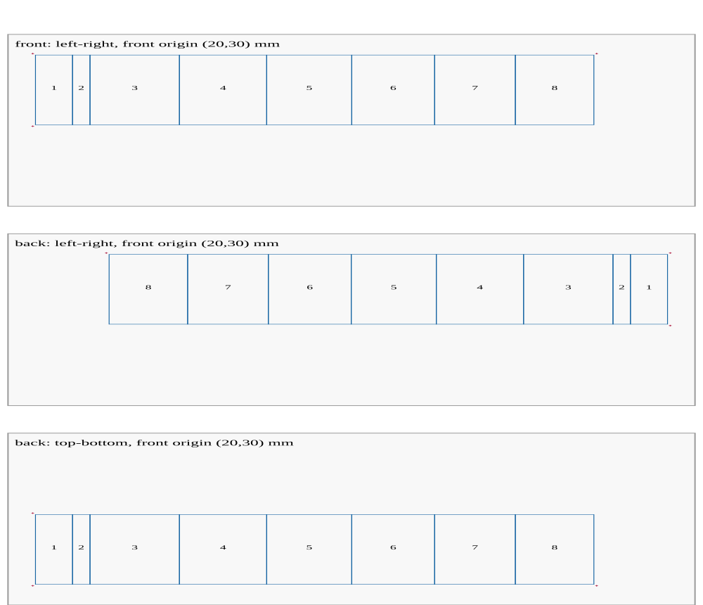

# Cassette J-card profiles

Select a named manufacturer profile. All listed inserts are 101.6 mm high.
Each physical panel can have front and back artwork; face selection is separate
from panel count. Each face produces its own plot job. No scaling occurs.

| Profile | Panels | Width (mm) | Example sheet |
| --- | ---: | ---: | --- |
| `standard-jcard-3-panel-v1` | 3 | 103.1875 | Letter |
| `standard-jcard-4-panel-v1` | 4 | 168.275 | A4 |
| `standard-jcard-5-panel-v1` | 5 | 230.1875 | Letter |
| `standard-jcard-6-panel-v1` | 6 | 290.5125 | A3 |
| `standard-jcard-7-panel-v1` | 7 | 349.25 | Tabloid |
| `standard-jcard-8-panel-v1` | 8 | 406.4 | A3 |
| `nac-jcard-8-panel-v1` (default) | 8 | 406.4 | A3 |

The Standard three-panel flap is 25.4 mm wide; the first panel of the other
Standard formats is 26.9875 mm. These are explicit verified records, not a
truncated eight-panel template. The five-panel nominal total is 9.0625 inches;
the source headline rounds it to 9.063. See the
[checked dimensions, source PDFs and hashes](jcard-profile-sources.md) and
[complete multi-format configs](../how-to/jcard-formats.md).

Sheet fit includes configured margins and enabled registration marks. Smaller
formats can fit Letter/A4; the table gives tested examples, not automatic paper
selection. Converter support for a custom sheet still requires a device profile.
Safe inset defaults to nominal 1.5875 mm, diagnostic only; bleed reference is
3.175 mm, with no generated bleed artwork. The green source guide centers have
small rounding differences described in the source record.

## Eight-panel reference layout

The `nac-jcard-8-panel-v1` profile describes one flat cassette insert. It has eight
physical panels. Each panel can have front and back artwork, for up to sixteen
artwork surfaces. The software exports each selected face as a separate plot job.

The trim size is **406.4 × 101.6 mm**. The program does not shrink the insert to fit
the paper. Use A3, tabloid, or a custom sheet with sufficient space. A4 and letter
do not fit at this scale. Confirm your plotter's usable area separately.

## Panel dimensions

All panels are 101.6 mm high. Coordinates below start at the front's left edge.

| Physical panel | Role | Width (mm) | Front start (mm) |
| --- | --- | ---: | ---: |
| panel-1 | Tracklisting | 26.9875 | 0 |
| panel-2 | Title/spine | 12.7 | 26.9875 |
| panel-3 | Front artwork | 65.0875 | 39.6875 |
| panel-4 | Extension 1 | 63.5 | 104.775 |
| panel-5 | Extension 2 | 61.9125 | 168.275 |
| panel-6 | Extension 3 | 60.325 | 230.1875 |
| panel-7 | Extension 4 | 58.7375 | 290.5125 |
| panel-8 | Extension 5 | 57.15 | 349.25 |

Native views keep artwork upright. The back view reverses physical panel order.
These are flat face coordinates, not a simulation of the folded cassette insert.

```text
Front, left to right: [1][2][    3    ][   4   ][   5   ][  6  ][  7  ][  8  ]
Back,  left to right: [  8  ][  7  ][  6  ][   5   ][   4   ][    3    ][2][1]
Slot IDs: front-panel-1 ... front-panel-8; back-panel-1 ... back-panel-8
```

## Configuration

Unknown fields fail validation. Numeric controls reject booleans and nonfinite
values. Recipe paths are relative to the configuration file.

| Field | Values | Default / requirement |
| --- | --- | --- |
| `schema_version` | `1` | Required |
| `profile` | A profile ID from the table above | `"nac-jcard-8-panel-v1"` |
| `faces` | `"front"`, `"back"`, `"both"` | `"front"` |
| `sheet` | `"letter"`, `"a4"`, `"a3"`, `"tabloid"`, or width/height object | Required; must fit selected trim and enabled marks |
| `margin_mm` | Nonnegative number | `0`; keep trim and enabled marks inside this margin |
| `origin_mm` | `[x, y]` in mm | Centered; explicit coordinates locate the front trim |
| `flip` | `"left-right"`, `"top-bottom"` | `"left-right"` |
| `safe_inset_mm` | `0 <= value < 6.35` | `1.5875`; diagnostic only |
| `guides` | Object with `cut`, `fold`, `registration` booleans | All `false` |
| `front_artwork`, `back_artwork` | Face recipe objects | Exactly the selected faces |
| Face `template` | JSON recipe path | Required |
| Face `mode` | `"independent"`, `"continuous"` | `"independent"` |
| Face `blank_panels` | Unique slot IDs belonging to that face | `[]` |

Custom sheet dimensions must be finite positive numbers, with width >= height
and width <= 1,000,000 mm. `origin_mm: null` is invalid; omit the field to center.

`independent` generates each panel in its own coordinates. `continuous` generates
one face composition and partitions it into panels. Neither mode connects the two
paper faces. The initial recipe adapter supports structured region-fill recipes
for `truchet` and `truchet-multiscale`.

Blank declarations suppress artwork during imposition. They do not remove a
canvas, replace missing files, or change generation. Prepare every selected profile panel, including blank ones. An all-blank face retains its full sheet size and
catalog. No unused opposite-face job is emitted.

## Paper flip and registration

Let the sheet be `Sx × Sy`, with front trim origin `(X,Y)` and trim `W × H`.
Both sides use the same front-reference origin. Do not independently center or
fit the back artwork.

| Face / flip | Native trim-to-sheet transform in mm |
| --- | --- |
| Front | `(x+X, y+Y)` |
| Back, left-right | `(x+Sx-X-W, y+Y)` |
| Back, top-bottom | `(X+W-x, Sy-Y-y)` |

```text
Physical paper point after a flip:
left-right: (x,y) -> (Sx-x,y)     top-bottom: (x,y) -> (x,Sy-y)
native back art: translated      native back art: rotated 180 degrees
```

Both artwork transforms preserve handedness. Strokes are not mirrored. Top-bottom
rotates the entire native back view by 180 degrees. Off-center placement is
supported. Confirm the intended physical flip with the diagnostic previews.



This diagnostic compresses sheet height for readability. It is not a plotting
template. Production SVGs retain exact physical scale.

Optional registration crosses have 1 mm half-arms. Front centers are
`(X-2,Y-2)`, `(X+W+2,Y-2)`, and `(X-2,Y+H+2)`. The back uses the physically flipped
centers. This asymmetric three-corner arrangement helps identify a wrong flip.
All cross extrema must fit the drawable sheet. The program fails instead of
moving or shrinking them.

Cut is one trim outline; folds are seven unique panel seams. Enabled guide
channels are `jcard-cut-guides`, `jcard-fold-guides`, and `jcard-registration`.
An enabled guide ID cannot duplicate an artwork layer ID. Guides are plotted ink;
they do not operate a cutter or fold paper. Safe-inset diagnostics are not ink.
The vendor's **3.175 mm bleed** is reference information only; this feature does
not generate bleed. Artwork clips to trim, including internal continuous seams.

## Output and integrity

Export writes selected `front/` and `back/` folders with `artwork-job.json`,
`layout-handoff.json`, and `layout-preview.svg`. Root `jcard-export.json` records
the selected faces and hashes. Each face also has `sheet-preview.svg`: a diagnostic
of physical placement, panel labels, safe inset and enabled guide strokes. This
preview contains text and diagnostic ink; do not plot it. Prepared sources use the existing neutral bundle
format and crop-restoration workflow.

Imposition writes selected face folders containing `design.svg` and `design.json`.
Keep the accompanying `design.imposition.json` beside them: the converter uses it
to validate the local authoritative catalog, manifest hash and physical sheet.
Root `jcard-jobs.json` lists the separate jobs and hashes. Source dimensions must
match the named profile within 0.000001 mm. Source, recipe, face, layout and
manifest mismatches fail. Front and back can use different layer catalogs. Their
catalogs are not merged. Each face preserves its hashes and source path metadata.

Publication is atomic across the selected faces. A second-face failure leaves the
previous complete output intact. Use `--overwrite` only for an existing recognized
export/job directory. Output must not overlap input recipes or asset bundles.

## Dimension sources

The nominal dimensions follow the [National Audio Company cassette templates](https://www.nationalaudiocompany.com/cassette-duplication/prepare-your-audio-and-your-album-art/cassette-art-templates/).
The profile uses panel labels and nominal dimensions, not PDF page dimensions.
Standard Cassette formats have separately checked records linked above. Unlisted
manufacturer formats still require independent measurement. Physical stock, fold direction, case fit
and duplex registration remain unverified until a paper proof is completed.

Reference PDF SHA-256 values (PDF files are not distributed here):

| Template | SHA-256 |
| --- | --- |
| NAC_Jcard_8-Panel_FRONT_Template_AI5.pdf | `8dfe10291a646e884b4c317ed1cc6b847d9db53a3590c9c6eb47c193f08a5e80` |
| NAC_Jcard_8-Panel_BACK_Template_AI5.pdf | `8552dd0c28befa0c4fc2d435df7691e2d4df10e9ae00560c63340c008d6fad0b` |

See the [complete JSON and operator workflow](../how-to/cassette-jcard.md).
