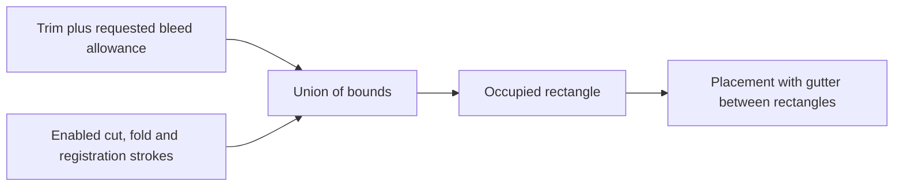
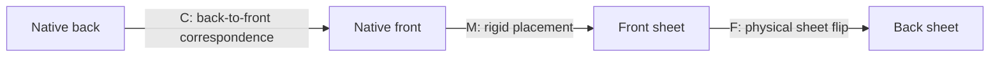

# Exact-scale sheet packing

Pack whole imposition objects without changing their size. The first CLI adapter
supports J-cards. The Python packing core also accepts polygon footprints and
packs their rectangular bounds. It does not nest polygons into unused corners
or holes. Booklet and cootie-catcher adapters are future work.

Use `python scripts/pack_impositions.py --config CONFIG --output-dir DIRECTORY`.
Add `--overwrite` only to replace a recognized generated job. The command validates
prepared artwork and writes the complete job atomically. It does not generate
artwork, convert HP-GL, or operate the plotter. Follow the complete
[J-card packing example](../how-to/pack-jcards.md) to prepare inputs.

## Configuration

All distances are millimetres. Paths are relative to the packing JSON file.
Unknown fields, duplicate IDs, null controls and Boolean/string numbers are errors.

| Field | Values or shape | Default / requirement |
| --- | --- | --- |
| `schema_version` | `1` | Required |
| `sheet_mm` | `[width,height]`; finite, positive, each <= 1000000 | Required |
| `usable_front_mm` | `[x,y,width,height]`, within sheet | Whole sheet |
| `usable_back_mm` | Same shape; paired jobs only | Same rectangle as front |
| `margins_mm` | `[top,right,bottom,left]`, nonnegative | `[0,0,0,0]` |
| `gutter_mm` | Nonnegative separation between occupied rectangles | `0` |
| `strategy` | `auto`, `grid`, `maxrects` | `auto` |
| `faces` | `front`, `both` | `front` |
| `flip` | `left-right`, `top-bottom`; paired jobs only | `left-right` for `both` |
| `objects` | List of 1?128 object definitions below | Required |
| `logical_layers` | Explicit output catalog; nonempty list | Omit for identical source catalogs |

| Object field | Values or shape | Default / requirement |
| --- | --- | --- |
| `id` | Unique nonblank string, at most 200 characters | Required |
| `type` | `jcard` | Required |
| `profile` | `standard-jcard-3-panel-v1` through `standard-jcard-8-panel-v1`, or `nac-jcard-8-panel-v1` | Required |
| `quantity` | Integer 1?1000; total across definitions <=1000 | `1` |
| `rotations` | Nonempty unique subset of `[0,90]` | `[0]` |
| `bleed_allowance_mm` | Nonnegative trim allowance used to reserve space | `0` |
| `guides` | Object with Boolean `cut`, `fold`, `registration` fields | Each `false` |
| `front` | Face definition below | Required |
| `back` | Face definition below | Required for `both`; forbidden for `front` |

| Face field | Values or shape | Default / requirement |
| --- | --- | --- |
| `assets` | Prepared neutral asset directory | Required |
| `template` | Original artwork recipe JSON path | Required |
| `mode` | `independent`, `continuous` | `independent`; must match prepared assets |
| `blank_panels` | Unique physical IDs such as `front-panel-1` or `back-panel-3` | Empty list; face and profile must match |
| `layer_map` | Object mapping every source layer ID to an output layer ID | Required on every face with explicit output catalog |

Do not edit a recipe after preparing its assets. Re-export, generate and prepare
when the recipe, profile or mode changes. Blank panels still require valid source
assets; blank masking does not bypass viewport or provenance checks.

## Native coordinates and reserved space

Native coordinates use the trim's top-left as `(0,0)`, X right and Y down.
An enabled guide can extend into negative native coordinates. A rigid placement
maps this native datum to the sheet; it does not move the datum to a guide corner.
Angles 0 and 90 use exact quadrant matrices. There is no scale or shrink-to-fit.

Bleed allowance reserves space; it does not create additional artwork. Cut and
fold strokes lie on trim/seam geometry. Registration uses three cross centres at
`(-2,-2)`, `(width+2,-2)`, `(-2,height+2)`, with 1 mm arms. Thus registration adds
3 mm on each side of the trim bounds. The eight-panel trim is 406.4 by 101.6 mm;
with registration and no larger bleed allowance its occupied rectangle is
`[-3,-3,412.4,107.6]`. Gutter is additional space between occupied rectangles.
No trailing gutter is required outside the usable sheet.

## Paired sheets

Inset the physical sheet by the margins. Intersect this with the front usable
rectangle. For a paired job, also intersect it with the back's margin/usable area
reflected into front coordinates. An empty intersection is an error. The same
instances and sheet assignment serve both faces.

Matrices use SVG order `[a,b,c,d,e,f]`: `x'=a*x+c*y+e`, `y'=b*x+d*y+f`.
The back matrix is `F*M*C`, applied right to left. For J-cards,
`C=[-1,0,0,1,trim_width,0]`. `F` reflects around the physical sheet's vertical
axis for `left-right`, or its horizontal axis for `top-bottom`. The back is not
packed separately. Physical guides use the shared front-native datum and `F*M`.
Artwork on a rotated back can therefore have a different apparent rotation.

## Strategy and reproducibility

`auto` uses grid only when all occupied widths, heights and permitted rotations
match. Native origins and outline shapes can differ. Otherwise it uses MaxRects.

Grid chooses the permitted orientation with greatest per-sheet capacity, then
the smaller angle on a tie. Instances sort by ID and fill rows from top left.
MaxRects sorts by descending occupied area, descending largest side, then ID.
It tries existing sheets in order before opening another. Within a sheet it
scores short-side remainder, long-side remainder, Y, X, angle and free-list index.
It splits intersected free rectangles and removes contained duplicates.
Both methods are deterministic heuristics; neither guarantees the minimum number
of sheets. An object that cannot fit at any permitted angle stops the whole job.

## Logical layers and pens

Identical complete source catalogs can pass through unchanged. Different catalogs
require `logical_layers` and complete `layer_map` objects on every face, including
inactive source layers. Each output record needs a unique `id`, a nonblank `label` and contiguous
`ordinal` values starting at 1. Output metadata is authoritative under explicit
maps. Multiple source layers may map to one output layer.

Enabled guides get separate reserved IDs: `sheet-cut-guides`,
`sheet-fold-guides`, `sheet-registration`. Do not reuse them for artwork.
Packing retains logical layers. A schema-3 pen plan selects physical pen slots
at conversion; the packing config does not select pens.

## Outputs and work limits

| Output | Purpose |
| --- | --- |
| `packing.json` | Strategy, effective area, sources/hashes, transforms, instances, layer catalog, area totals and work counters |
| `placement-preview.svg` | Front-side occupied rectangles on all sheets; diagnostic, not a plot input |
| `sheet-001/front/design.svg` | Exact-scale neutral plot input; corresponding back folder for paired jobs |
| `design.json` beside each SVG | Neutral catalog, dimensions and SVG hash |
| `design.imposition.json` beside each SVG | Source provenance, panel audit and instance transforms |

Keep each plot SVG with both JSON sidecars. The complete multi-sheet job replaces
an old generated job only after all faces pass validation. Input/output overlap
is rejected. Output paths and hashes are recorded in the root audit.
`unused_area_mm2` is effective sheet area minus occupied rectangles; it includes
gutters and does not estimate polygon nesting efficiency.

| Work limit | Maximum |
| --- | ---: |
| Object definitions | 128 |
| Expanded instances | 1000 |
| Sheets | 256 |
| Live free rectangles per sheet | 4096 |
| Scored candidates | 2000000 |
| Composed vertices | 2000000 |
| Aggregate generated SVG bytes, including placement preview | 256 MiB |

Limits fail before the corresponding additional allocation/work. Repeated copies
count toward output limits. Geometric comparisons use 0.0000001 mm tolerance.
Library callers can provide smaller `PackingBudget` limits for their own jobs.
A custom physical page can be packed, but the converter/device must also support
that page. Software checks do not establish paper registration, stock clearance,
fold fit or duplex alignment; physical acceptance remains HAR-88.
