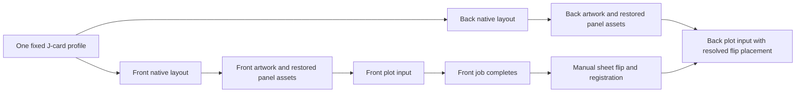

# Eight-panel cassette J-card

Status: proposed design for HAR-87. User selected single- or double-sided
artwork and separate plot jobs for the printed faces. Physical acceptance is
deferred. This document belongs to plotter-workflow; the isolated worktree is
stored under the viz_virtualserver workspace for the current session.

## Purpose and approaches

Add a reusable cassette insert object like the booklet and cootie catcher.
Generate artwork per panel or continuously across a face, retain semantic
panel identities, and impose it at the manufacturer's physical size.

Selected foundation: a named physical profile in plotter-workflow, exported
through the existing neutral polygon/layout handoff to viz_virtualserver.
This keeps dimensions, sheet placement and paper flipping in the imposition
project. A standalone flat SVG template is simpler but lacks panel bindings,
repeatable crop restoration and auditable side pairing. A cassette-specific
generator in viz_virtualserver would duplicate physical layout responsibilities.

Single-side and two-side generation share one object model. Two separate jobs
avoid requiring a mid-plot pause or automatic duplex transport. First delivery
supports flat front/back layouts and imposition, not a 3D folded simulation.

## Source geometry and named profile

Initial profile: `nac-jcard-8-panel-v1`. Support only this named format initially.
Reject unknown profiles and arbitrary panel-count substitutions. The catalogue's
3-, 4-, 5-, 6- and 7-panel designs are future profiles, each requiring its own
template measurements; do not truncate the eight-panel strip to imitate them.

All eight physical panels are 101.6 mm high. Widths below are exact nominal
dimensions from the user and the rendered manufacturer front/back labels.

| Physical ID | Role | Width, inches | Width, mm | Front start X, mm |
| --- | --- | --- | ---: | ---: |
| panel-1 | Tracklisting flap | 1 1/16 | 26.9875 | 0 |
| panel-2 | Title / spine | 1/2 | 12.7 | 26.9875 |
| panel-3 | Front / album art | 2 9/16 | 65.0875 | 39.6875 |
| panel-4 | Extension 1 | 2 1/2 | 63.5 | 104.775 |
| panel-5 | Extension 2 | 2 7/16 | 61.9125 | 168.275 |
| panel-6 | Extension 3 | 2 3/8 | 60.325 | 230.1875 |
| panel-7 | Extension 4 | 2 5/16 | 58.7375 | 290.5125 |
| panel-8 | Extension 5 | 2 1/4 | 57.15 | 349.25 |

Trim size is 406.4 by 101.6 mm (16 by 4 inches). Maintain this exact nominal
geometry, using exact rational/decimal source constants where practical before
conversion to the existing SVG scale of 96/25.4 units per mm. No whole-mm rounding.

Front view runs panel-1 through panel-8 left to right. Back view runs panel-8
through panel-1, also with upright local artwork. A panel's physical ID does not
change between faces. Face slot IDs are `front-panel-1` through `front-panel-8`
and corresponding `back-panel-N`. Bindings record physical ID, face and role.
Eight physical panels can therefore have sixteen artwork surfaces; they are not
booklet page numbers or sixteen independent pieces of paper.

For front panel start x_i and width w_i, back native start is W-x_i-w_i, W=406.4.
This reverses slot positions, not the pixels/strokes of the artwork. Source
artwork is not mirrored. Local source up is top-of-card on both native views.

Sources, downloaded and visually inspected:

- [Manufacturer catalogue](https://www.nationalaudiocompany.com/cassette-duplication/prepare-your-audio-and-your-album-art/cassette-art-templates/)
- [Eight-panel front PDF](https://nationalaudiocompany.com/wp-content/uploads/2017/08/NAC_Jcard_8-Panel_FRONT_Template_AI5.pdf)
- [Eight-panel back PDF](https://nationalaudiocompany.com/wp-content/uploads/2017/08/NAC_Jcard_8-Panel_BACK_Template_AI5.pdf)

Front SHA256: `8dfe10291a646e884b4c317ed1cc6b847d9db53a3590c9c6eb47c193f08a5e80`.
Back SHA256: `8552dd0c28befa0c4fc2d435df7691e2d4df10e9ae00560c63340c008d6fad0b`.
Do not commit vendor PDFs; record URLs/hashes and normalized measurements.

The PDF page is 1206 by 342 points, not the trim object. The front trim rectangle
is 1152 by 288 points. Outer green bleed bounds extend 9 points (3.175 mm) beyond
trim. Magenta safe guides are approximately 4.5 points (1.5875 mm) inside panel
bounds. Back PDF coordinates have small export offsets/rounding; use nominal
labels for canonical dimensions, not those sub-point shifts as new geometry.
Nominal safe inset 1.5875 mm is a builder proposal, not a user-specified clipping
rule. Safe and bleed guides do not redefine trim or silently change source size.

## Proposed controls and scope

These control names and defaults are proposals for approval; exact CLI names
and Python interfaces belong in the implementation plan.

| Control | Default | Values / behavior |
| --- | --- | --- |
| profile | nac-jcard-8-panel-v1 | Only this profile initially |
| faces | front | front, back, both |
| sheet | Required | Existing named/custom sheet support; finite positive mm dimensions |
| placement | Centered trim rectangle | Explicit front-reference X/Y may override |
| flip | left-right | left-right or top-bottom, defined below |
| artwork mode | independent | independent or continuous, separately per selected face |
| safe inset | 1.5875 mm | Finite nonnegative guide inset; must leave every panel positive |
| plot cut guides | false | Independent guide channel |
| plot fold guides | false | Independent guide channel |
| plot registration marks | false | Independent paired guide channel |

Validate strict types and finite values; reject Boolean dimensions, unsupported
profiles/faces/flip modes, contradictory face assignments, duplicate/missing
selected slots and foreign bindings. Unselected faces require no assignments
and produce no blank artwork bundle or plot job. Both mode selects all sixteen
slots across two face bundles, with no implicit sharing of front artwork to back.
An intentionally blank selected panel must be explicit and retain its canvas;
do not confuse a missing assignment with a blank surface.

Same-front output must be independent of whether back is also requested, and
vice versa. Stable per-face jobs/IDs/seeds ensure choosing both does not change
the already selected face's design. Front/back may use different recipes or
layers. Initial implementation does not need to merge two producer manifests
into one neutral logical-layer catalog: each face is an independent plot input.

At initial scope, artwork clips to exact panel trim canvases. Safe inset is a
guide for critical content, not automatic per-panel artwork clipping; continuous
artwork must be able to meet across fold seams. Vendor bleed is reference and
preview metadata only, not an implemented artwork-extension control. Actual
bleed generation is deferred instead of promised by a decorative green box.

## Sheet placement and explicit flip convention

Keep physical geometry in mm; convert at the handoff boundary. One front-reference
placement resolves a sheet width Sx, height Sy and trim origin (X,Y), with fixed
W=406.4 and H=101.6. Require the complete trim/selected guide geometry to fit the
declared drawable sheet rectangle. Reuse existing margin validation; no implicit
shrink-to-fit. A3 landscape and tabloid can accommodate the nominal strip with
suitable margins; letter/A4 cannot at true scale. Reject rather than scale it.
No claim about a particular plotter's drawable margins follows from sheet size.

The selected paper flip is a turnover about the sheet centerline, followed by
repositioning to the same sheet-coordinate datum. It is not an inference from
printer long-edge/short-edge terminology.

| Flip | Matching front point -> back sheet point | Back native frame -> sheet |
| --- | --- | --- |
| left-right | (Sx-x, y) | Translation by (Sx-X-W, Y) |
| top-bottom | (x, Sy-y) | Rotate native back 180 degrees, then translate to (X, Sy-Y-H) |

For top-bottom, the full transform is (u,v) -> (X+W-u, Sy-Y-v), for native back
coordinates (u,v). Left-right is (u,v) -> (Sx-X-W+u, Y+v). These source placement
matrices have positive determinant; neither mirrors artwork. Verify the set of
corners of each back physical panel equals the flipped front panel's corner set.
Do not independently center or auto-fit a back job from its visible paths.

Back-only output still uses the front-reference placement convention so it is
consistent with the same back job in both mode. Label that convention clearly
in its manifest/runbook. Off-center tests are essential; a centered strip can
hide an incorrect flip implementation.

Paired registration crosses refer to the same physical sheet locations under
the flip map and live outside trim. Make their enabled pattern deterministic,
asymmetric and bounded in available drawable space so it identifies orientation.
Fail if requested marks do not fit; do not relocate or shrink them silently.
Exact cross geometry/inset and manifest names are implementation-plan decisions.
Diagnostic labels may be SVG text in previews; production registration marks
and guides must be explicit vector strokes, not unresolved fonts.

## Object, artwork and imposition handoff

Implement the cassette object/profile in plotter-workflow using its Object,
Slot, Guide and physical placement conventions. Extend existing artwork layout,
binding and asset-preparation dispatch only where the new object requires it.
Avoid a new universal folding framework or a second canvas engine.

Export one neutral layout and artwork job per selected face, with eight local
rectangular canvases and face-native composition transforms. In continuous mode
all eight panels share one 406.4 by 101.6 mm face canvas before partitioning.
In independent mode each selected slot gets its own artwork domain. Front and
back never share a single continuous artwork canvas or clip into one another.

Existing recipe adapters currently constrain continuous Truchet templates.
Reuse that supported path for continuous examples. Add only the scoped template
handling necessary for independent cassette jobs; keep geometry export neutral
and compatible with existing producer algorithms. Do not claim an unsupported
recipe is runnable. Preserve prior booklet/cootie exports and adapter validation.

viz_virtualserver receives standard domains, surfaces and transforms and returns
standard per-surface SVGs. It needs no cassette-specific generator or physical
fold knowledge. Prepare cropped assets back into their complete local panel
canvases using the existing recorded crop offsets. Impose each prepared face
bundle at exact scale with its resolved sheet transform applied once. Preserve
neutral layer catalogs, path IDs, hashes and producer/layout provenance. Reject
stale layouts, mismatched dimensions/faces and assets from the wrong profile.

The final outputs for both are separate front/back SVG plot inputs and manifests,
with one paired-job record referencing both side hashes and the shared placement
and flip convention. Subsequent existing SVG-to-HPGL/pen planning stays separate.
Single-face mode emits one plot input and its manifest, plus diagnostic metadata;
it must not require or emit an unused opposite-side plot input.

The diagram shows both mode. Single-face mode follows only its selected branch.

Cut outline follows trim; fold guides are the seven panel boundaries. Keep guides
out of artwork producer domains and layer catalogs unless explicitly added at
the physical imposition stage. No fold arrows or mountain/valley semantics are
invented from the 2D template. Guide-only preview remains available regardless
of which guide channels are selected for plotting.

## Operator flow and deferred physical acceptance

Generate/prepare both faces, inspect labeled previews and configure pens before
transmission. Plot front to completed state; move the arm to its normal idle
position using the established workflow; flip/reposition the sheet using the
declared convention and registration method; then send the back job. No command
automatically flips paper, resumes a paused front job or starts the second job.

Physical registration accuracy, stock/fold tolerance, roll-fold behavior and
cassette-case fit require a future proof. Keep these as explicit backlog
acceptance work. Software can prove coordinate relationships, not physical
repeatability. Do not label a folded view physically verified without that proof.

## Verification and documentation

- Exact panel widths/height/summed trim, all seven seams, source hashes and
  separate native face ordering. Other profiles/counts fail rather than inherit
  an unverified decrement rule.
- Front, back and both selection; stable paired physical IDs; no extra side
  output; explicit blank panels; same selected-face bytes/seeds regardless of
  whether the other face is selected.
- Both flip maps on centered and off-center placements, non-square sheets,
  asymmetric corner/edge markers, upright native labels and no mirrored artwork.
  Corner-set identities and transform round trips, not just screenshot matching.
- Physical scale, drawable margins, inset/guide fit and letter/A4 rejection;
  no source-bounds fit depending on sparse/blank artwork. Plot guides are opt-in.
- Independent and shared face jobs through actual viz generation, crop
  restoration and imposition. Verify adjacency, per-panel containment, blank
  dimensions, orientation, neutral channels and lineage. No producer changes
  unless a test demonstrates a genuine generic-contract gap.
- Atomic multi-file output, paired-job consistency, path/hash/profile/side
  mismatches and invalid manifests. Fail before replacing a valid bundle.
- Existing booklet/cootie/layout/binding/source regressions and relevant neutral
  exporter tests, with focused iteration then affected subsystem verification.
  No mandatory blanket full suite or hardware run.
- Complete self-contained single-front, single-back and both-side examples;
  parameter tables, dimensioned native face diagrams, sheet-flip diagrams,
  separated guides and sequential-job runbook in plain technical English.

Builder calls for approval: profile/control names, default front/left-right,
required explicit sheet, nominal safe inset, trim-only artwork scope, both flip
maps and separate per-face export with paired provenance. Exact functions,
commands, immutable record types, mark geometry and test file boundaries belong
in the plan. After written-design approval, prepare a native implementation plan
and use one fresh final whole-branch review. Keep HAR-87 In Progress until merge.

## Builder and author checks

Fresh builder check: nothing important left. Source geometry, printed-face
selection, paper-flip semantics, trim-only scope, job separation and reuse of
existing handoff contracts are specified sufficiently for planning.

Author verified exact width totals and 96 physical-panel corner-set identities
using rational arithmetic: eight panels, both flips, centered/off-center
placements and three non-square sheet sizes. This checks geometry proposals,
not hardware registration. Vendor front/back PDFs were rendered and inspected;
dimensions and guide rectangles were checked separately from PDF page bounds.
No product implementation or pytest run was performed for this design.
