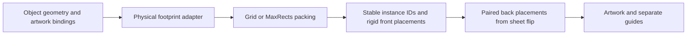

# HAR-91: Grid and MaxRects packing study

Status: throwaway visual prototype, not a production design or plot-ready tool.
The user selected grid plus MaxRects and asked that irregular impositions remain
possible. Production API, output atomicity and true polygon nesting are not built.

## Existing code and boundary

This is `plotter-workflow` work, isolated on `spike/har91-sheet-packing`, based on
merged main `dd7c0ab`. The retained J-card worktree and all existing artwork remain
unchanged. The generator repository does not need a new packing algorithm.

Existing `imposition.jcard_profiles` supplies verified trim dimensions. Existing
`jcard_placement` places one object and validates guides in a paired sheet datum.
The prototype imports the profile dimensions. It does not replace that exporter
or apply its back-artwork conventions to new multi-object jobs.

The intended boundary is:



The packing stage moves whole physical objects. It does not pack each facet
separately, change internal folds, scale artwork, or impose artwork adjacency.

## Prototype assumptions

| Control | Study value | Limitation |
| --- | --- | --- |
| Sheet | A3 landscape, 420 x 297 mm | Does not certify device usable area |
| Outer margins | 3 mm | Same on all sides in this study |
| Gutter | 4 mm between reserved rectangles | Defined separately from trim clearance |
| Object envelope | 3 mm around trim bounds | Illustrative combined reservation, not actual bleed generation |
| Rotations | 0 or 90 degrees | Explicit item policy; arbitrary-angle nesting is not implemented |
| Identical copies | Deterministic grid | Select highest capacity orientation; stable tie rule |
| Mixed footprints | MaxRects best-short-side-fit | Deterministic heuristic, not guaranteed optimal |
| Overflow | Additional sheets | Stable IDs are assigned before sorting |
| Duplex | Left-right physical footprint preview; both axes checked numerically | Not prepared back artwork or physical registration validation |

The MaxRects study sorts by reserved area, maximum side and stable instance ID.
It searches existing sheets in order, with deterministic short-side/long-side,
position and rotation tie rules. It splits all intersected free rectangles and
removes contained free rectangles. A virtual trailing gutter allows edge objects
to fit without requiring an extra gutter outside the usable area.

The prototype uses an independent small Python implementation with no new
dependency. The algorithm-family reference is
[Jylanki's RectangleBinPack repository](https://github.com/juj/RectangleBinPack).
Its documentation describes these methods as approximate heuristics.

## Results

Run from this worktree:

```powershell
../pancake-prototype/.venv/Scripts/python.exe -m prototypes.har91_sheet_packing
```

| Case | Objects | Sheets | Reserved area mm2 | Trim polygon area mm2 |
| --- | ---: | ---: | ---: | ---: |
| Two eight-panel cards | 2 | 1 | 88,748.5 | 82,580.5 |
| Three-panel grid with overflow | 8 | 2 | 93,988.6 | 83,870.8 |
| Mixed three/four/eight-panel formats | 5 | 2 | 105,375.4 | 96,451.4 |
| Mixed overflow | 8 | 2 | 180,250.2 | 165,322.2 |
| Three triangles and three L shapes | 6 | 1 | 86,496.0 | 45,600.0 |

The two eight-panel envelopes each measure 412.4 x 107.6 mm. Two rows and one
4 mm gutter require 219.2 mm vertically. The usable area is 414 x 291 mm, so this
case fits under the stated assumptions without rescaling.

The irregular case reserves about 1.90 times its trim area. That difference
includes the illustrative 3 mm envelopes as well as empty corners of bounds.
It is evidence of space that polygon-aware nesting might recover, not a claim
that a particular number of additional objects can fit.

Outputs in `output/har91-sheet-packing/`:

- Each named SVG shows front and corresponding back footprints. Blue is trim;
  dashed blue lines show J-card folds. Orange is the conservative envelope.
- `two-eight-panel.png`, `irregular-conservative.png` and `mixed-overflow.png`
  are rendered inspection images.
- `study.json` records instance IDs, sheet numbers, rotations, raw trim polygons,
  reserved bounds, rigid front/back matrices, areas and an oversized-item failure.

## Checks performed

Inline assertions check in-bounds reserved footprints, nonoverlap with gutters,
stable output under input reversal, unique instance IDs, unit-determinant front
transforms, unchanged trim edge lengths, both sheet-flip corner correspondences,
and an actionable oversized-item failure. Duplex round trips use a 1e-9 mm
tolerance for floating-point subtraction. Ruff and diff checks pass.

This spike has no pytest suite, dependency changes or hardware actions. SVG/PNG
previews were inspected. Production validation, deterministic work limits,
atomic publication, full artwork binding and per-guide extents remain design
and implementation tasks. Linear was read but not written.

## Irregular-object contract and open choice

Keep the physical trim outline separate from its rectangular packing envelope.
Use native millimetre coordinates and a stable local datum. An object can later
provide a union of outer polygons, holes and guide/bleed keepout geometry. Fold
lines and artwork gaps do not automatically become holes available for nesting.
Packing strategies should return the same instance/sheet/rigid-transform records
so a future polygon strategy does not change artwork bindings or duplex export.

The current study conservatively packs irregular bounds. It does not rotate
shapes into each other's empty corners. Whether the initial production scope
must include polygon-aware nesting is the remaining user choice. The recommended
first step is the rectangular engine with this extensible footprint boundary;
true nesting is a separate geometry/search problem.
